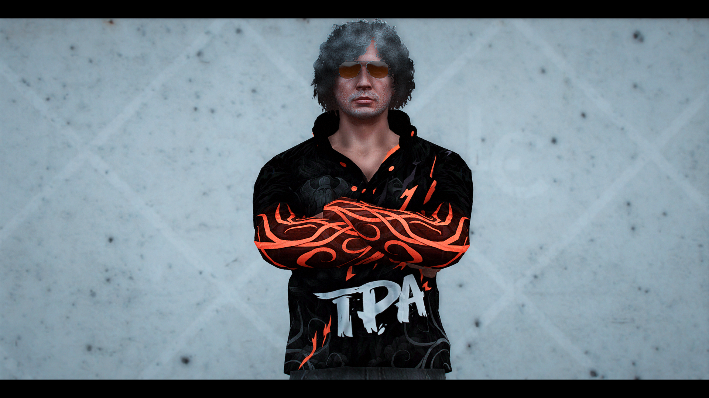
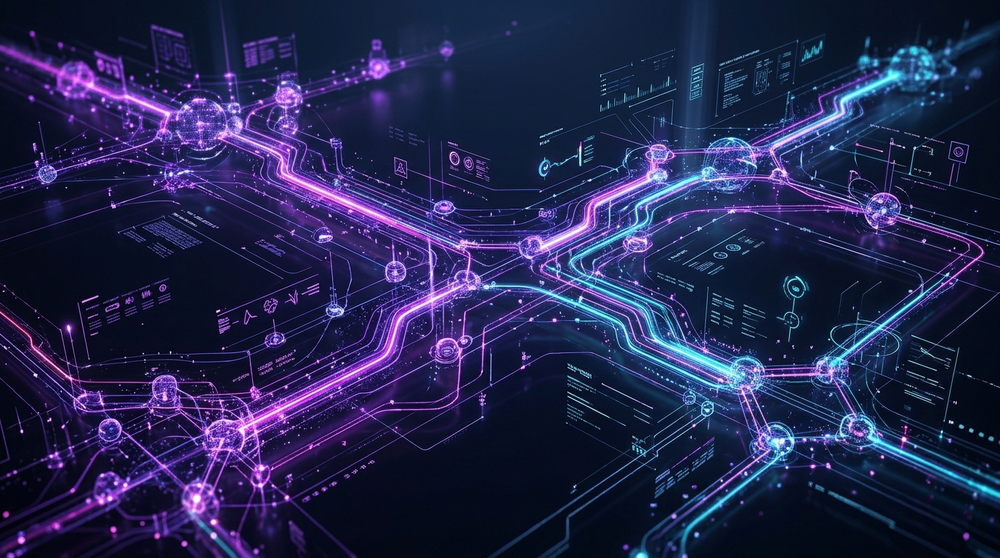
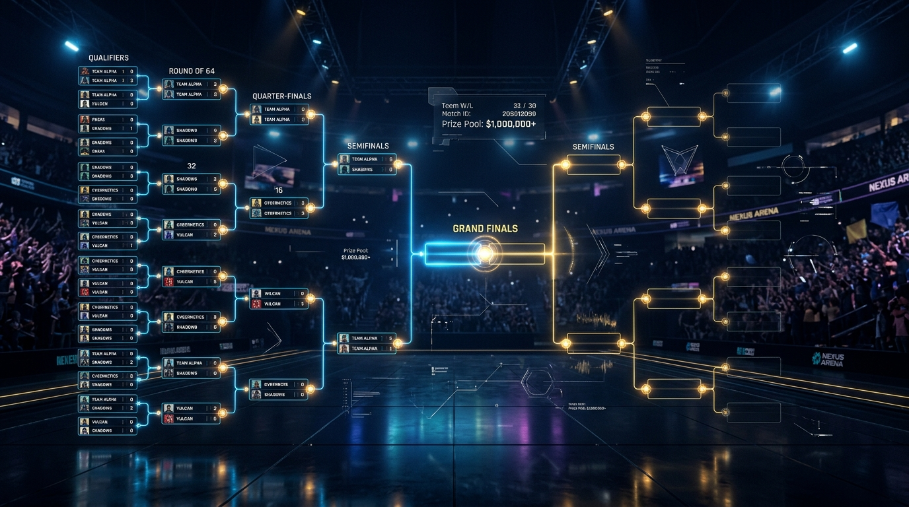
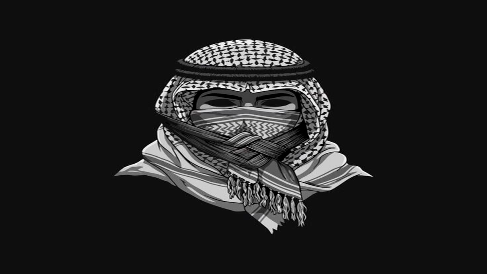
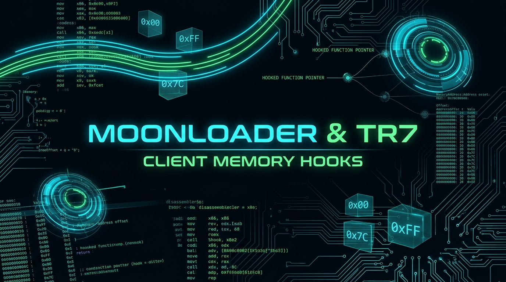
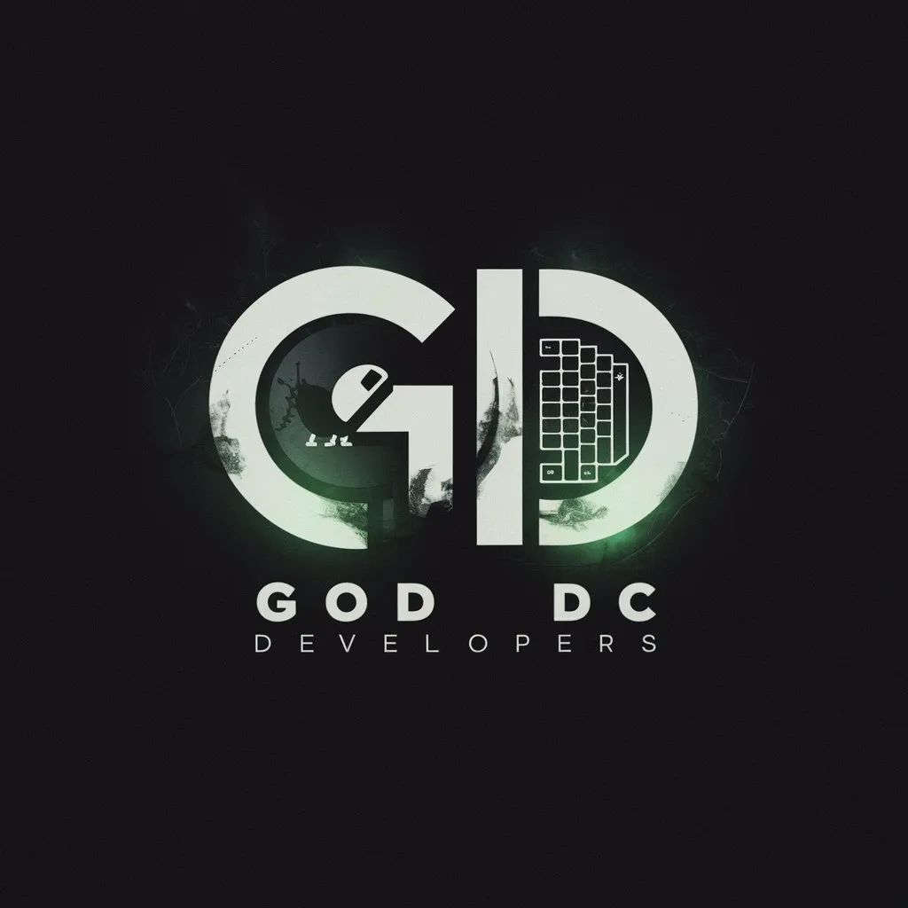

<div align="center">

  <!-- Header Banner -->
  

  <!-- Dynamic Typing Subtitle -->
  <a href="https://git.io/typing-svg">
    
  </a>

  <br />

  <!-- Social & Contact Badges -->
  <p align="center">
    <a href="mailto:notseegoddc@gmail.com">
      
    </a>
    <a href="https://discord.com">
      
    </a>
    <a href="https://github.com/SEE17">
      
    </a>
  </p>

</div>

---

### 👨‍💻 Executive Summary

```text
Software engineer, systems developer, and desktop tools architect. I specialize in building 
standalone Windows performance utilities, competitive game modifications (FiveM & SA-MP), 
and enterprise-grade Discord bot automation grids capable of high-concurrency throughput.
```

- 🚀 **Desktop & Kernel Tools**: Standalone Windows executables (`n0t.see.exe`), low input-latency game debloaters, audio soundboard suites
- 🎮 **Game Mechanics & 3D Mapping**: FiveM realistic recoil physics, custom MLO 3D world mapping, MoonLoader client hooks, and open.mp systems
- 🤖 **Bot Infrastructure**: High-volume auto-dispatch grids, esports tournament bracket engines, automated image verification filters
- 💬 **Discord Handle**: `n0t.see`
- 📫 **Direct Inquiries**: [notseegoddc@gmail.com](mailto:notseegoddc@gmail.com)

---

### 🛠️ Verified Arsenal & Tech Stack

<div align="center">

| Domain | Systems & Frameworks |
| :--- | :--- |
| **Desktop & Systems** |  |
| **Game Engines & Scripting** |  |
| **Web & Automation Runtimes** |  |
| **Databases & State Sync** |  |
| **DevOps & Workspace** |  |

</div>

---

### 📊 Production Experience by File Volume

```
PAWN (SA-MP / OPEN.MP)       [████████████████████]  10,000+ files • Gamemodes, textdraws, dynamic systems
JAVASCRIPT / NODE.JS         [██████████████████░░]   7,000+ files • Discord bots, automation gateways, REST APIs
LUA (MOONLOADER / FIVEM)     [████████████████░░░░]   2,100+ files • Client hooks, ox_lib, HUDs, memory utilities
TYPESCRIPT                   [██████████████░░░░░░]   1,400+ files • Typed bot architectures & backend microservices
C / C++ (WIN32 / ASM)        [█████████████░░░░░░░]     800+ files • Native DLL hooks, Linux .so plugins, memory scans
SQL (MYSQL / SQLITE)         [████████████░░░░░░░░]     200+ files • oxmysql, high-concurrency player database persistence
C# (.NET / STANDALONE APPS)  [███████████░░░░░░░░░]     100+ files • Standalone executables, n0t.see.exe, launchers
```

---

### 🚀 Production Software & Featured Builds

<table>
  <!-- Row 1: Desktop Software & FiveM Physics -->
  <tr>
    <td width="50%" valign="top">
      <h3 align="center">⚡ Apex Boost — Standalone Windows FPS Optimizer</h3>
      <p align="center">
        
      </p>
      <p align="center">
        
        
      </p>
      <p>A standalone Windows gaming performance utility compiled with C# and Electron. Designed to strip background latency, optimize DWM frame buffers, unthrottle GPU power profiles, and eliminate micro-stutters in competitive games.</p>
      <ul>
        <li><b>Automated Restore Point Guard</b>: Creates snapshot checkpoints via PowerShell before applying registry tweaks</li>
        <li><b>Telemetry & Bloat Purge</b>: Silences background Windows telemetry, DiagTrack, and background application permissions</li>
        <li><b>Low Input-Lag Tweaks</b>: Fine-tunes system timer resolution and process priority for maximum frametimes</li>
      </ul>
      <p align="center">
        
        
        
      </p>
    </td>
    <td width="50%" valign="top">
      <h3 align="center">🎯 47_Recoil & Weapon Dynamics Engine</h3>
      <p align="center">
        
      </p>
      <p align="center">
        
        
      </p>
      <p>Modular weapon physics and handling engine engineered for competitive FiveM roleplay and PvP servers. Implements realistic weapon recoil curves, camera suppression effects, and screen-shake dynamics.</p>
      <ul>
        <li><b>Realistic Recoil Curves</b>: Weapon-specific upward and horizontal recoil kick calculation per fire cycle</li>
        <li><b>Dynamic Drunk & Stress Camera</b>: Procedural screen shakes that respond to continuous fire and suppression</li>
        <li><b>Zero Resmon Overhead</b>: Highly optimized client loop consuming &lt;0.01ms tickrate</li>
      </ul>
      <p align="center">
        
        
        
      </p>
    </td>
  </tr>

  <!-- Row 2: Discord Automation & Tournament Ecosystem -->
  <tr>
    <td width="50%" valign="top">
      <h3 align="center">🤖 High-Volume AutoDM & GodDC Infrastructure</h3>
      <p align="center">
        
      </p>
      <p align="center">
        
      </p>
      <p>High-throughput automated messaging and notification dispatch grid built with rate-limit evasion, multi-account rotation, and live delivery telemetry.</p>
      <ul>
        <li><b>Token Pool Management</b>: Dynamic rotation of bot tokens with intelligent backoff to prevent API bans</li>
        <li><b>Automated Verification Filters</b>: Filters active targets, checks permissions, and logs real-time delivery status</li>
        <li><b>Anti-Spam Bypasses</b>: Randomized message hashing and variable dispatch intervals</li>
      </ul>
      <p align="center">
        
        
        
      </p>
    </td>
    <td width="50%" valign="top">
      <h3 align="center">🏆 Tournament Management Ecosystem</h3>
      <p align="center">
        
      </p>
      <p align="center">
        
      </p>
      <p>Comprehensive esports tournament coordination system engineered for large competitive Discord communities. Automates the full bracket lifecycle, match schedules, and roster verifications.</p>
      <ul>
        <li><b>Dynamic Bracket Engine</b>: Automatic generation and live updates for single-elimination, double-elimination, and Swiss brackets</li>
        <li><b>Automated Channel Lifecycle</b>: Creates and secures match-specific voice and text rooms with automated role permissions</li>
        <li><b>Dispute & Score Reporting</b>: Interactive slash-command workflows for screenshot submission and admin arbitration</li>
      </ul>
      <p align="center">
        
        
        
      </p>
    </td>
  </tr>

  <!-- Row 3: 3D Mapping & Memory Client Tools -->
  <tr>
    <td width="50%" valign="top">
      <h3 align="center">🗺️ TPAGH 3D Spatial Architecture & MLO Streaming</h3>
      <p align="center">
        
      </p>
      <p align="center">
        
        
      </p>
      <p>Custom 3D world mapping, custom interior shells (MLO), collision meshes, and occlusion boundaries engineered for high-end FiveM roleplay servers.</p>
      <ul>
        <li><b>Optimized 3D Collision Models</b>: Custom <code>.ydr</code> and <code>.ytyp</code> definitions preventing player glitch-throughs</li>
        <li><b>Occlusion Geometry</b>: Custom <code>.ymap</code> occlusion meshes to eliminate frame drops across dense interiors</li>
        <li><b>High-Res Texture Dictionaries</b>: Compressed <code>.ytd</code> textures optimized for streaming without memory crashes</li>
      </ul>
      <p align="center">
        
        
        
      </p>
    </td>
    <td width="50%" valign="top">
      <h3 align="center">🎮 MoonLoader & TR7 Client Memory Hooks</h3>
      <p align="center">
        
      </p>
      <p align="center">
        
      </p>
      <p>Custom client-side modifications and runtime memory tools for GTA San Andreas and SA-MP. Features custom UI menus, noclip utilities, dynamic actor spawning, and low-level memory patches.</p>
      <ul>
        <li><b>TR7 Menu Hook</b>: In-game interactive graphical menu with real-time memory address toggling</li>
        <li><b>Noclip & Telemetry Utilities</b>: Smooth coordinate interpolation with custom collision bypasses</li>
        <li><b>Dynamic Actor & Effect Engine</b>: Scripted NPC routines, custom particle systems, and textdraw overlays</li>
      </ul>
      <p align="center">
        
        
        
      </p>
    </td>
  </tr>

  <!-- Row 4: Soundboard & Roleplay Server Ecosystem -->
  <tr>
    <td width="50%" valign="top">
      <h3 align="center">🔊 n0t_see Audio Soundboard Suite</h3>
      <p align="center">
        
      </p>
      <p>Standalone desktop audio management suite with global hotkey triggers, instant audio clip routing, and low-latency virtual cable integration for Discord and in-game voice chat.</p>
      <ul>
        <li><b>Low-Latency Playback</b>: High-frequency direct audio stream mixing with sub-10ms trigger delay</li>
        <li><b>Global Hotkey Interceptor</b>: Works across all full-screen games and background applications without focus loss</li>
        <li><b>Dynamic UI & Sound Packs</b>: Modular sound library manager with customizable volume gain normalization</li>
      </ul>
      <p align="center">
        
        
        
      </p>
    </td>
    <td width="50%" valign="top">
      <h3 align="center">🏙️ DUBAI v1 & Bloodline PvP Framework</h3>
      <p align="center">
        
      </p>
      <p align="center">
        
        
      </p>
      <p>Competitive multiplayer roleplay and deathmatch gamemodes featuring custom inventory logic, vehicle speedometers, killfield zones, and synchronized Discord bots.</p>
      <ul>
        <li><b>Dynamic Actor & Event Systems</b>: Integrated musical chairs, automated killfields, and procedural loot zones</li>
        <li><b>Instant Server Restart Engine</b>: Custom <code>restartsystem.inc</code> with automated state recovery and zero data loss</li>
        <li><b>High-Concurrency MySQL Layer</b>: Non-blocking asynchronous query processing supporting 300+ concurrent players</li>
      </ul>
      <p align="center">
        
        
        
      </p>
    </td>
  </tr>
</table>

---

### 📊 GitHub Activity & Real-Time Metrics

<div align="center">

  <table border="0">
    <tr>
      <td align="center">
        
      </td>
      <td align="center">
        
      </td>
    </tr>
  </table>

  <br />

  <!-- Activity Contribution Graph -->
  

</div>

---

### 💬 Connect & Direct Inquiries

<div align="center">

Interested in custom desktop software, Discord bot infrastructure, or high-performance game mechanics?

<br />

<a href="mailto:notseegoddc@gmail.com">
  
</a>
&nbsp;
<a href="https://discord.com">
  
</a>

<br /><br />

```
"Engineering with precision. Real software. Zero bloat."
```

</div>

---

<div align="center">

  

  <sub>Crafted for <b>SEE17</b> • Discord: <b>n0t.see</b> • Desktop Systems & Game Engineering</sub>

</div>
